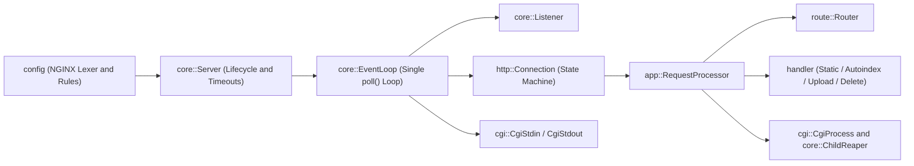
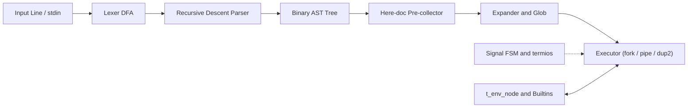

  
  <h1>42GS</h1>
  

    <strong>42 Curriculum Systems &amp; Network Portfolio by @gdtknight (yoshin)</strong>
  

  

    
    
  

  

    <a href="https://github.com/42GS/.github/blob/main/profile/README.md">한국어</a> | <strong>English</strong>
  

---

## About

**42GS** is the portfolio workspace of **[@gdtknight](https://github.com/gdtknight) (`yoshin`)**, organizing systems and network engineering projects built during the 42 curriculum. Each entry distinguishes solo work from team projects and lists collaborators explicitly.

Across these repositories, work follows a consistent engineering loop. Projects start by reading primary RFC and POSIX specifications and measuring OS behavior differences between `macOS` and `Ubuntu`, then implement core engines without external libraries. Automated tests, memory/FD leak checks, and CI verify the code, while design decisions and retrospectives remain versioned in companion wikis.

### Quick Guide for Reviewers

* **Quick overview of scope and metrics**: Start with [Projects at a Glance](#projects-at-a-glance) below to compare `webserv` and `minishell` side by side.
* **HTTP server architecture and decision logs**: See [`webserv` Architecture](https://github.com/42GS/webserv/blob/main/docs/architecture.en.md) and the [19 ADRs in `webserv-wiki`](https://github.com/42GS/webserv-wiki/blob/main/wiki/analysis/design-decisions.md) *(ADRs are in Korean)*.
* **Parser, IPC, signals, and redesign metrics**: See [`minishell`](https://github.com/42GS/minishell) and the [Legacy Comparison Retrospective](https://github.com/42GS/minishell-wiki/blob/main/wiki/eval/legacy_retrospective.md) *(written in Korean with English technical identifiers)*.

---

## Projects at a Glance

| Project | Ownership & Role | Stack | Verification Summary | Engineering Archive |
| :--- | :--- | :--- | :--- | :--- |
| **[`webserv`](https://github.com/42GS/webserv/blob/main/README.en.md)** (`v1.0.0`) | 2-person team (`yoshin`, `jyoo`) `webserv-wiki` authored by `yoshin` | C++98, POSIX Sockets, `poll()`, CGI/1.1, Python | `105/105` C++98 unit tests, `124` TCP integration cases, Valgrind, Electric Fence, `siege` | **[`webserv-wiki`](https://github.com/42GS/webserv-wiki/blob/main/README.en.md)** (`v1.0.1`) `67` primary sources/benchmarks · `111` pages · `19` ADRs |
| **[`minishell`](https://github.com/42GS/minishell)** (`v1.1.0`) | Solo (`yoshin`) Design, implementation, QA, CI | C99, POSIX.1-2017, Readline, Valgrind, GHCR CI | `37/37` (100%) 42evalhub E2E, `-50.6%` core LOC, `0` heap/FD leaks · `29~36s` CI | **[`minishell-wiki`](https://github.com/42GS/minishell-wiki)** (`v1.0.1`) `33` docs · 7-stage linter CI (`0 Errors`) |

---

## Featured Projects

### [`webserv`](https://github.com/42GS/webserv/blob/main/README.en.md) (`v1.0.0`) · [`webserv-wiki`](https://github.com/42GS/webserv-wiki/blob/main/README.en.md) (`v1.0.1`)

> 2-person team (`yoshin`, `jyoo` · Oct 16–29, 2026) · `webserv-wiki` authored by `yoshin`

An RFC 9112-compliant HTTP/1.1 and CGI/1.1 server written in **C++98** with POSIX system calls and zero external dependencies. One `poll()` loop in a single process drives all listening sockets, client connections, and CGI pipes, executing at most one non-blocking I/O call per readiness event.

* **Protocol & Routing**: Supports `keep-alive`, HTTP pipelining, incremental `Content-Length` and `Transfer-Encoding: chunked` parsing, `multipart/form-data` uploads (`201`/`409`/`413`), `DELETE` (`204`), and CGI/1.1 (`fork`/`execve`, `10s` timeout returning `504`, `ChildReaper`). Parses NGINX-style configs (`12` directives) with longest-prefix matching, segment-boundary `alias` checks, and `400` rejection for `..` traversal.
* **Stability & Constraints**: Streams files over `1 MiB` in `64 KiB` chunks and transitions through a `DRAIN` state before closing sockets to avoid TCP `RST`. Works around forbidden standard time functions with a `stat()`-based `Clock`, pauses listener `POLLIN` on FD exhaustion until slots reopen, strips `Proxy` headers against `httpoxy` (`CVE-2016-5385`), and caps CGI output at `16 MiB` using `std::string::swap` without extra copies.
* **Verification & Releases**: Verified with **105/105** C++98 unit tests (`make test`), **11** Python 3 TCP integration suites (**124** cases), Valgrind, Electric Fence, and `siege` load runs, with GitHub Actions CI building Linux (`x86_64`) and macOS (`arm64`) release binaries.

Its companion repository, [`webserv-wiki`](https://github.com/42GS/webserv-wiki/blob/main/README.en.md), collects **67** primary sources and `macOS`/`Ubuntu 22.04` measurements (`53` external specs + `14` OS/tool benchmarks), **111** wiki pages (`66` sources, `14` concepts, `6` analysis docs, `21` lessons, `4` top-level files), and **19 ADRs**. The 21 study chapters and 13 concept notes are also published on the [GitHub Wiki](https://github.com/42GS/webserv/wiki) *(wiki contents are in Korean with English technical references)*.

* **Links**: [Repository (EN)](https://github.com/42GS/webserv/blob/main/README.en.md) · [Architecture](https://github.com/42GS/webserv/blob/main/docs/architecture.en.md) · [Configuration Reference](https://github.com/42GS/webserv/blob/main/docs/configuration.en.md) · [Changelog](https://github.com/42GS/webserv/blob/main/CHANGELOG.en.md) · [Public Wiki](https://github.com/42GS/webserv/wiki) · [Engineering Wiki (EN)](https://github.com/42GS/webserv-wiki/blob/main/README.en.md) · [19 ADRs (KO)](https://github.com/42GS/webserv-wiki/blob/main/wiki/analysis/design-decisions.md)

---

### [`minishell`](https://github.com/42GS/minishell) (`v1.1.0`) · [`minishell-wiki`](https://github.com/42GS/minishell-wiki) (`v1.0.1`)

> Solo project (`yoshin`: architecture, implementation, QA, and CI)

A POSIX.1-2017 Unix shell written in **C99** (`GNU Readline`, `Valgrind`, `Docker (GHCR)`, `GitHub Actions`, `Python`) without invoking any standard shell. Architecture specifications for the parser, execution engine, signals, and builtins were drafted in [`minishell-wiki`](https://github.com/42GS/minishell-wiki) prior to writing C code; combined with OS/compiler deep dives and the post-implementation retrospective, the knowledge base totals **33** documents alongside a 5-layer test and CI pipeline.

#### Key Engineering Tradeoffs

* Signal handlers only write to a single `volatile sig_atomic_t g_signal_num` to stay async-signal-safe, while `ctx->interrupted` separates `SIGINT` aborts from normal `(exit 130)` results so `&&`/`||` short-circuiting behaves accurately.
* To prevent 64KB pipe buffer deadlocks on large Here-docs, the collector opens anonymous temporary files with `O_CREAT | O_EXCL` (`0600`) and unlinks them immediately, closing sibling branch descriptors via `close_ast_heredocs()`.
* Without `realloc` in the allowed function set, a capacity-doubling `t_strbuf` keeps expansion and stdin reads `O(N)`. A parallel quote mask (`t_exp_buf.mask`) suppresses `*` globbing inside single or double quotes.

#### Redesign Outcomes, 5-Layer QA & Knowledge Base

After sealing the earlier implementation (`minishell-old`) and rebuilding from scratch, same-machine comparison (`LC_ALL=C`) cut core LOC (excluding `libft`) from `7,883` to `3,896` (**`-50.6%`**, total `9,283 -> 4,476` LOC) with `0` Norminette errors and **58 files documented with Doxygen**. External symbols comply strictly (`0` forbidden symbols among `33` linked, single global `g_signal_num`), and the 42evalhub 5-suite E2E pass rate rose from `20/37` (`54.1%`, 3 timeouts) to **`37/37` (`100%`)**.

Verification spans `7` C unit suites, `47` Bash-differential smoke checks, `37` 42evalhub cases, `8` PTY signal tests, and `13` Valgrind QA scenarios (`0` heap or FD leaks). Introducing a slim `ghcr.io/42gs/minishell-ci:latest` image, static archive reuse, and parallel Valgrind runs lowered CI runtime from `77~80s` to **`29~36s` (`-62.3%`)**. [`minishell-wiki`](https://github.com/42GS/minishell-wiki) houses 4 architecture specs, 4 OS/compiler deep dives, a 53-function compliance matrix, an evaluation defense matrix, and the legacy retrospective, gated by a 7-stage markdown and Mermaid linter (`scripts/lint_wiki.py`, `0 Errors`).

* **Links** *(Korean documentation with English code and technical identifiers)*: [Repository](https://github.com/42GS/minishell) · [GitHub Wiki](https://github.com/42GS/minishell/wiki) · [Knowledge Base](https://github.com/42GS/minishell-wiki) · [Full Catalog](https://github.com/42GS/minishell-wiki/blob/main/index.md) · [Architecture Specs](https://github.com/42GS/minishell-wiki/tree/main/wiki/architecture) · [Legacy Retrospective](https://github.com/42GS/minishell-wiki/blob/main/wiki/eval/legacy_retrospective.md)

---

## Repositories

| Repository | Stack | Ownership & Role | Summary | Status |
| :--- | :--- | :--- | :--- | :--- |
| **[`42GS/webserv`](https://github.com/42GS/webserv/blob/main/README.en.md)** | C++98, Python | 2-person team (`yoshin`, `jyoo`) | RFC 9112 HTTP/1.1 & CGI/1.1 server (`poll()` event loop) | Featured (`v1.0.0`) |
| **[`42GS/webserv-wiki`](https://github.com/42GS/webserv-wiki/blob/main/README.en.md)** | Markdown | Authored by `yoshin` | Primary source notes, OS benchmarks, 19 ADRs, study guide | Featured (`v1.0.1`) |
| **[`42GS/minishell`](https://github.com/42GS/minishell)** | C99, Python | Solo (`yoshin`) | POSIX.1-2017 Unix shell (DFA, AST, IPC, 5-layer QA & CI) | Featured (`v1.1.0`) |
| **[`42GS/minishell-wiki`](https://github.com/42GS/minishell-wiki)** | Markdown | Solo (`yoshin`) | 4-part architecture specs, CS deep dives, evaluation & retrospective | Featured (`v1.0.1`) |
| **[`42GS/ft_transcendence`](https://github.com/42GS/ft_transcendence)** | TypeScript, React, Fastify, PostgreSQL | 5-person team (`yoshin`: Gomoku & Othello engine/UI) | Real-time two-player web board game platform (`Cyber Board Café`) | Portfolio Cleanup Pending |

> **Comparison Archives**: [`42GS/minishell-old`](https://github.com/42GS/minishell-old) and [`42GS/webserv-old`](https://github.com/42GS/webserv-old) are preserved as pre-redesign baselines for retrospective comparison.

---

## Maintainer & Collaborators

* **Portfolio Owner & Maintainer**: **[@gdtknight](https://github.com/gdtknight)** (`yoshin`) — `42GS` maintainer; solo author of `minishell` / `minishell-wiki`, co-author of `webserv` & author of `webserv-wiki`, game engine & board UI developer for `ft_transcendence`
* **Organization Member & Project Collaborators**: **[@Sunbear95](https://github.com/Sunbear95)** (`42GS` member) · `jyoo` (`webserv` co-author) · `jyoo`, `yunhpark`, `sipyeon`, `dong-hki` (`ft_transcendence` teammates)
