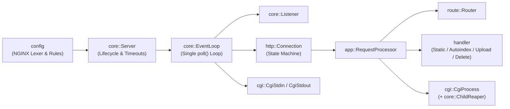

  
  <h1>42GS</h1>
  

    <strong>C/C++ systems and network projects from the 42 curriculum.</strong>
  

  

    
    
  

  

    <a href="https://github.com/42GS/.github/blob/main/profile/README.md">한국어</a> | <strong>English</strong>
  

---

## About

**42GS** is a team workspace for systems and backend projects built in the 42 curriculum. We work directly from RFC and POSIX specifications without external libraries, test OS-level behavior across `macOS` and `Ubuntu`, and keep the resulting measurements alongside the code.

---

## Featured Project

### [`webserv`](https://github.com/42GS/webserv) — HTTP/1.1 Web Server in C++98

An RFC 9112-compliant HTTP/1.1 server written in **C++98** with zero external dependencies. One `poll()` loop in a single process drives every listening socket, client connection, and CGI pipe, performing at most one non-blocking `recv()`, `send()`, or pipe I/O per readiness event.

* **Protocol &amp; Routing:** Supports `keep-alive`, pipelining, chunked decoding, `multipart/form-data` uploads (`201`/`409`/`413`), and CGI/1.1 (`fork`/`execve`). Configuration follows NGINX syntax (`12` directives) with longest-prefix matching and segment-boundary `alias` checks.
* **Stability &amp; Constraints:** Streams files larger than `1 MiB` in `64 KiB` chunks and drains connections (`DRAIN` state) before closing to prevent TCP `RST`. Handles forbidden standard time functions via a `stat()`-based `Clock`, pauses listeners on FD exhaustion (`EMFILE`), and strips `Proxy` headers against `httpoxy` (`CVE-2016-5385`).
* **Verification:** **105/105** C++98 unit tests (`make test`), **11** Python TCP integration suites (**124** cases), Valgrind and Electric Fence checks, and `siege` load testing.

* **Links:** [Repository](https://github.com/42GS/webserv) · [Architecture &amp; Design](https://github.com/42GS/webserv/blob/main/docs/architecture.md) · [Configuration Reference](https://github.com/42GS/webserv/blob/main/docs/configuration.md) · [Changelog](https://github.com/42GS/webserv/blob/main/CHANGELOG.md)

---

## Design &amp; Verification Archive

### [`webserv-wiki`](https://github.com/42GS/webserv-wiki) — Decision Logs &amp; OS Benchmarks

The engineering wiki built alongside `webserv`, holding primary-source notes, OS experiments, and post-implementation study material *(written in Korean with English technical references)*.

* **`wiki/sources/`:** Summaries of RFC 9110, 9112, 3875, 7578, NGINX behavior, and POSIX specs, paired with empirical comparisons between `macOS` and `Ubuntu 22.04` (half-closed pipe `poll()` bits, `413` drain vs. TCP reset, `siege 4.0.7` behavior).
* **`wiki/analysis/`:** [18 design decisions](https://github.com/42GS/webserv-wiki/blob/main/wiki/analysis/design-decisions.md), [subject-vs-evaluation conflict notes](https://github.com/42GS/webserv-wiki/blob/main/wiki/analysis/subject-vs-evaluation.md), [module interface design](https://github.com/42GS/webserv-wiki/blob/main/wiki/analysis/design.md), [test plan](https://github.com/42GS/webserv-wiki/blob/main/wiki/analysis/test-plan.md), and [mock evaluation results](https://github.com/42GS/webserv-wiki/blob/main/wiki/analysis/mock-evaluation.md).
* **`wiki/lessons/`:** 21 walkthrough notes linking RFC rules and POSIX system calls directly to `webserv` source lines.

* **Explore:** [Repository](https://github.com/42GS/webserv-wiki) · [Overview](https://github.com/42GS/webserv-wiki/blob/main/wiki/overview.md) · [Wiki Index](https://github.com/42GS/webserv-wiki/blob/main/wiki/index.md)

---

## Repositories

| Repository | Stack | Summary | Status |
| :--- | :--- | :--- | :--- |
| **[`42GS/webserv`](https://github.com/42GS/webserv)** | C++98, Python | RFC 9112 HTTP/1.1 &amp; CGI/1.1 server (`poll()` event loop) | Featured (`v1.0.0`) |
| **[`42GS/webserv-wiki`](https://github.com/42GS/webserv-wiki)** | Markdown | Design decisions, OS measurements, and technical wiki | Documentation Archive |
| **[`42GS/minishell`](https://github.com/42GS/minishell)** | C | POSIX-style interactive shell (lexer, parser, pipes, signals, builtins) | Docs &amp; Tests Pending |

---

## Maintainers

* **[@gdtknight](https://github.com/gdtknight)** (`yoshin`)
* **[@Sunbear95](https://github.com/Sunbear95)**
