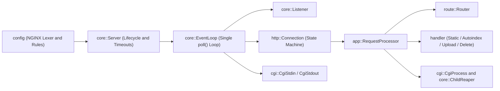
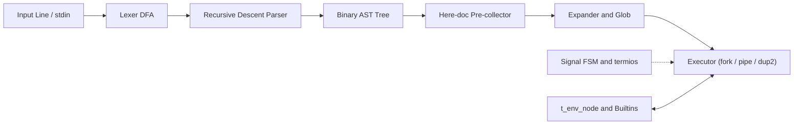

  
  <h1>42GS</h1>
  

    <strong>C/C++ Systems &amp; Network Programming Projects (RFC · POSIX)</strong>
  

  

    
    
  

  

    <a href="https://github.com/42GS/.github/blob/main/profile/README.md">한국어</a> | <strong>English</strong>
  

---

Zero-dependency RFC and POSIX implementations with `macOS`/`Ubuntu` measurements, automated verification (Valgrind, E2E, CI), and companion engineering wikis.

## Repositories

| Repository | Stack | Scope | Summary &amp; Verification |
| :--- | :--- | :--- | :--- |
| **[`42GS/webserv`](https://github.com/42GS/webserv/blob/main/README.en.md)** (`v1.0.0`) | C++98, `poll()`, Python | 2-person team (`yoshin`, `jyoo`) | RFC 9112 HTTP/1.1 &amp; CGI/1.1 server · `105/105` unit, `124` TCP cases, Valgrind/EF/`siege` |
| **[`42GS/webserv-wiki`](https://github.com/42GS/webserv-wiki/blob/main/README.en.md)** (`v1.0.1`) | Markdown | Authored by `yoshin` | `67` primary sources/benchmarks, `111` wiki pages, `19` ADRs, `21` study chapters |
| **[`42GS/minishell`](https://github.com/42GS/minishell)** (`v1.1.0`) | C99, POSIX.1-2017, Python | Solo (`yoshin`) | Unix shell · `37/37` 42evalhub, `-50.6%` core LOC, `0` leaks, `29~36s` CI |
| **[`42GS/minishell-wiki`](https://github.com/42GS/minishell-wiki)** (`v1.0.1`) | Markdown, Python | Solo (`yoshin`) | `33` docs (architecture, CS deep dives, eval matrix, retrospective), 7-stage linter CI (`0 Errors`) |
| **[`42GS/ft_transcendence`](https://github.com/42GS/ft_transcendence)** | TypeScript, React, Fastify, PostgreSQL | 5-person team (Gomoku &amp; Othello engine/UI) | Real-time two-player board game platform (`Cyber Board Café`) · Cleanup pending |

Legacy baselines: [`42GS/minishell-old`](https://github.com/42GS/minishell-old) · [`42GS/webserv-old`](https://github.com/42GS/webserv-old)

---

## Core Projects

### [`webserv`](https://github.com/42GS/webserv/blob/main/README.en.md) (`v1.0.0`) · [`webserv-wiki`](https://github.com/42GS/webserv-wiki/blob/main/README.en.md) (`v1.0.1`)

`C++98` · `POSIX Sockets` · `poll()` · `CGI/1.1` · `2-person team (Oct 16–29, 2026)`

Zero-dependency RFC 9112 HTTP/1.1 &amp; CGI/1.1 server — single-process `poll()` non-blocking event loop multiplexing listeners, client sockets, and CGI pipes.

* **Protocol &amp; Routing**: `keep-alive`, HTTP pipelining, incremental `Content-Length`/chunked parsing, `multipart/form-data` uploads (`201`/`409`/`413`), `DELETE` (`204`), CGI/1.1 (`fork`/`execve`, `10s` timeout `504`, `ChildReaper`), `12` NGINX-style directives, longest-prefix matching, segment-boundary `alias` checks, `400` rejection for `..` traversal
* **Stability &amp; System Constraints**: `64 KiB` chunked streaming for files over `1 MiB`, `DRAIN` state before socket close (TCP `RST` avoidance), `stat()`-based `Clock` workaround for forbidden time functions, listener `POLLIN` pause/resume on FD exhaustion, `Proxy` header stripping (`httpoxy` / `CVE-2016-5385`), `16 MiB` CGI output cap with `std::string::swap` zero-copy transfer
* **Verification &amp; Wiki**: `105/105` C++98 unit tests (`make test`), `11` Python TCP integration suites (`124` cases), Valgrind · Electric Fence · `siege`, Linux (`x86_64`) / macOS (`arm64`) release CI / `webserv-wiki` with `67` primary sources/OS benchmarks, `111` pages, `19` ADRs, [public study wiki](https://github.com/42GS/webserv/wiki) (`21` chapters, KO)

[Repository (EN)](https://github.com/42GS/webserv/blob/main/README.en.md) · [Architecture](https://github.com/42GS/webserv/blob/main/docs/architecture.en.md) · [Configuration Reference](https://github.com/42GS/webserv/blob/main/docs/configuration.en.md) · [Changelog](https://github.com/42GS/webserv/blob/main/CHANGELOG.en.md) · [Public Wiki (KO)](https://github.com/42GS/webserv/wiki) · [Engineering Wiki (EN)](https://github.com/42GS/webserv-wiki/blob/main/README.en.md) · [19 ADRs (KO)](https://github.com/42GS/webserv-wiki/blob/main/wiki/analysis/design-decisions.md)

---

### [`minishell`](https://github.com/42GS/minishell) (`v1.1.0`) · [`minishell-wiki`](https://github.com/42GS/minishell-wiki) (`v1.0.1`)

`C99` · `POSIX.1-2017` · `GNU Readline` · `Valgrind` · `GHCR CI` · `Solo`

POSIX Unix shell without standard-shell assistance — spec-first architecture documentation, C implementation, and 5-layer automated QA.

* **Parser · IPC · Signals**: DFA lexer → recursive descent AST → Here-doc pre-collector → expander/globbing → `(N-1)` pipe IPC and 7 builtins, single `g_signal_num` async-signal-safe 4-state machine (`ctx->interrupted` short-circuit separation), `O_CREAT | O_EXCL` (`0600`) + immediate `unlink()` anonymous Here-docs (64KB pipe deadlock avoidance &amp; `close_ast_heredocs()`), `O(N)` `t_strbuf`, quote-masked (`t_exp_buf.mask`) `*` globbing
* **Redesign vs. Legacy**: `-50.6%` core LOC vs. `minishell-old` (`7,883 -> 3,896` LOC; total `9,283 -> 4,476` LOC), `0` Norminette errors, `58` Doxygen-documented files, `0` forbidden external symbols (`33` allowed), 42evalhub E2E pass rate `20/37 (54.1%) -> 37/37 (100%)`
* **Verification &amp; Wiki**: `7` C unit suites, `47` Bash-differential smoke checks, `37` 42evalhub cases, `8` PTY signal tests, `13` Valgrind QA scenarios (`0` heap/FD leaks), GHCR parallel CI `77~80s -> 29~36s` (`-62.3%`) / `minishell-wiki` with `33` docs (4 architecture specs, CS deep dives, eval matrix, retrospective) and 7-stage linter CI (`0 Errors`)

*(KO docs with EN code/identifiers)*: [Repository](https://github.com/42GS/minishell) · [GitHub Wiki](https://github.com/42GS/minishell/wiki) · [Knowledge Base](https://github.com/42GS/minishell-wiki) · [Catalog](https://github.com/42GS/minishell-wiki/blob/main/index.md) · [Architecture Specs](https://github.com/42GS/minishell-wiki/tree/main/wiki/architecture) · [Legacy Retrospective](https://github.com/42GS/minishell-wiki/blob/main/wiki/eval/legacy_retrospective.md)

---

**Maintainer**: [@gdtknight](https://github.com/gdtknight) · **Collaborators**: [@Sunbear95](https://github.com/Sunbear95) · jyoo (`webserv`, `ft_transcendence`) · yunhpark · sipyeon · dong-hki (`ft_transcendence`)
