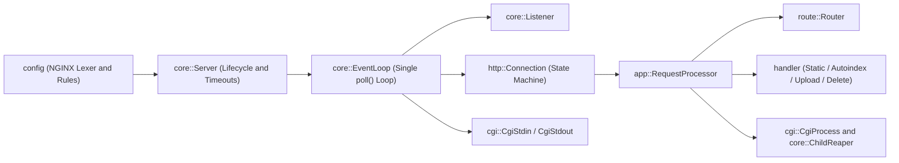
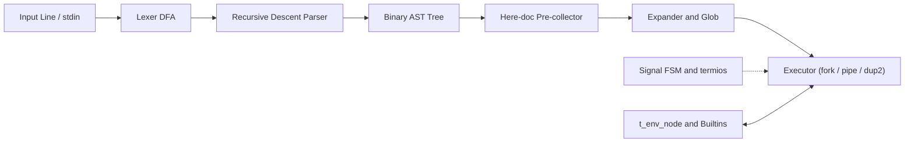

  
  <h1>42GS</h1>
  

    <strong>42 Curriculum Systems &amp; Network Portfolio by @gdtknight (yoshin)</strong>
  

  

    
    
  

  

    <a href="https://github.com/42GS/.github/blob/main/profile/README.md">한국어</a> | <strong>English</strong>
  

---

**42GS** is the systems and network programming portfolio of **[@gdtknight](https://github.com/gdtknight) (`yoshin`)** from the 42 curriculum. Projects are built directly against RFC and POSIX specifications without external libraries, with `macOS`/`Ubuntu` measurements and automated test results kept alongside the code.

## Projects

| Repository | Ownership &amp; Role | Stack | Summary &amp; Verification |
| :--- | :--- | :--- | :--- |
| **[`42GS/webserv`](https://github.com/42GS/webserv/blob/main/README.en.md)** (`v1.0.0`) | 2-person team (`yoshin`, `jyoo`) | C++98, `poll()`, Python | RFC 9112 HTTP/1.1 &amp; CGI/1.1 server · `105/105` unit, `124` TCP cases, Valgrind/EF/`siege` |
| **[`42GS/webserv-wiki`](https://github.com/42GS/webserv-wiki/blob/main/README.en.md)** (`v1.0.1`) | Authored by `yoshin` | Markdown | `67` primary sources/benchmarks, `111` pages, `19` ADRs, `21` study chapters |
| **[`42GS/minishell`](https://github.com/42GS/minishell)** (`v1.1.0`) | Solo (`yoshin`) | C99, POSIX.1-2017, Python | Unix shell · `37/37` 42evalhub, `-50.6%` core LOC, `0` leaks, `29~36s` CI |
| **[`42GS/minishell-wiki`](https://github.com/42GS/minishell-wiki)** (`v1.0.1`) | Solo (`yoshin`) | Markdown, Python | `33` docs (architecture, CS deep dives, eval matrix, retrospective), 7-stage linter CI (`0 Errors`) |
| **[`42GS/ft_transcendence`](https://github.com/42GS/ft_transcendence)** | 5-person team (`yoshin`: Gomoku &amp; Othello engine/UI) | TypeScript, React, Fastify, PostgreSQL | Real-time two-player board game platform (`Cyber Board Café`) · Cleanup pending |

> [`42GS/minishell-old`](https://github.com/42GS/minishell-old) and [`42GS/webserv-old`](https://github.com/42GS/webserv-old) are preserved as pre-redesign baselines for retrospective comparison.

---

## Featured Projects

### [`webserv`](https://github.com/42GS/webserv/blob/main/README.en.md) (`v1.0.0`) · [`webserv-wiki`](https://github.com/42GS/webserv-wiki/blob/main/README.en.md) (`v1.0.1`)

`2-person team (yoshin, jyoo · Oct 16–29, 2026) · webserv-wiki authored by yoshin`

An RFC 9112-compliant HTTP/1.1 and CGI/1.1 server written in **C++98** with a single-process `poll()` loop and zero external dependencies. Listening sockets, client connections, and CGI pipes are handled non-blockingly within one event loop.

* **Protocol &amp; Routing**: Supports `keep-alive`, pipelining, incremental chunked parsing, `multipart/form-data` uploads (`201`/`409`/`413`), `DELETE` (`204`), CGI/1.1 (`fork`/`execve`, `10s` timeout `504`), `12` NGINX-style directives, longest-prefix matching, segment-boundary `alias` checks, and `400` rejection for `..` traversal.
* **Stability &amp; Constraints**: Streams files over `1 MiB` in `64 KiB` chunks and transitions through `DRAIN` before closing to avoid TCP `RST`. Replaces forbidden time functions with a `stat()`-based `Clock`, pauses listeners on FD exhaustion, strips `Proxy` headers against `httpoxy` (`CVE-2016-5385`), and caps CGI output at `16 MiB` via `std::string::swap`.
* **Verification &amp; Wiki**: Verified by `105/105` C++98 unit tests, `11` Python TCP integration suites (`124` cases), Valgrind, Electric Fence, `siege`, and Linux (`x86_64`) / macOS (`arm64`) release CI. `webserv-wiki` holds `67` primary sources and OS benchmarks, `111` pages, `19` ADRs, and a [public study wiki](https://github.com/42GS/webserv/wiki) (21 chapters, in Korean).

[Repository (EN)](https://github.com/42GS/webserv/blob/main/README.en.md) · [Architecture](https://github.com/42GS/webserv/blob/main/docs/architecture.en.md) · [Configuration Reference](https://github.com/42GS/webserv/blob/main/docs/configuration.en.md) · [Changelog](https://github.com/42GS/webserv/blob/main/CHANGELOG.en.md) · [Public Wiki (KO)](https://github.com/42GS/webserv/wiki) · [Engineering Wiki (EN)](https://github.com/42GS/webserv-wiki/blob/main/README.en.md) · [19 ADRs (KO)](https://github.com/42GS/webserv-wiki/blob/main/wiki/analysis/design-decisions.md)

---

### [`minishell`](https://github.com/42GS/minishell) (`v1.1.0`) · [`minishell-wiki`](https://github.com/42GS/minishell-wiki) (`v1.0.1`)

`Solo project (yoshin)`

A POSIX.1-2017 Unix shell written in **C99** (`GNU Readline`, `Valgrind`, `Docker (GHCR)`) without invoking any standard shell. Architecture specs were finalized in `minishell-wiki` prior to C implementation and verified with a 5-layer test and CI pipeline.

* **Design &amp; Tradeoffs**: Structured as DFA lexer → recursive descent AST → Here-doc pre-collector → expander/globbing → `(N-1)` pipe IPC and 7 builtins. Uses a single `g_signal_num` async-signal-safe 4-state machine (`ctx->interrupted`), `O_CREAT | O_EXCL` + immediate `unlink()` anonymous Here-docs (avoiding 64KB pipe deadlocks), `O(N)` `t_strbuf`, and quote-masked (`t_exp_buf.mask`) `*` globbing.
* **Redesign vs. Legacy**: Cut core LOC by `-50.6%` (`7,883 -> 3,896` LOC) compared to `minishell-old`, with `0` Norminette errors, `58` Doxygen-documented files, `0` forbidden external symbols, and 42evalhub E2E pass rate rising from `20/37 (54.1%)` to `37/37 (100%)`.
* **Verification &amp; Wiki**: Passes `7` C unit suites, `47` Bash-differential smoke checks, `37` 42evalhub cases, `8` PTY signal tests, and `13` Valgrind QA scenarios (`0` heap/FD leaks), with GHCR container parallelization cutting CI runtime from `77~80s` to `29~36s` (`-62.3%`). `minishell-wiki` houses `33` docs (4 architecture specs, CS deep dives, eval matrix, retrospective) gated by a 7-stage linter CI (`0 Errors`).

*(Korean documentation with English code and technical identifiers)*: [Repository](https://github.com/42GS/minishell) · [GitHub Wiki](https://github.com/42GS/minishell/wiki) · [Knowledge Base](https://github.com/42GS/minishell-wiki) · [Catalog](https://github.com/42GS/minishell-wiki/blob/main/index.md) · [Architecture Specs](https://github.com/42GS/minishell-wiki/tree/main/wiki/architecture) · [Legacy Retrospective](https://github.com/42GS/minishell-wiki/blob/main/wiki/eval/legacy_retrospective.md)

---

**Maintainer**: **[@gdtknight](https://github.com/gdtknight)** (`yoshin`)  
**Collaborators**: **[@Sunbear95](https://github.com/Sunbear95)** (`42GS` member) · `jyoo` (`webserv`) · `jyoo`, `yunhpark`, `sipyeon`, `dong-hki` (`ft_transcendence`)
