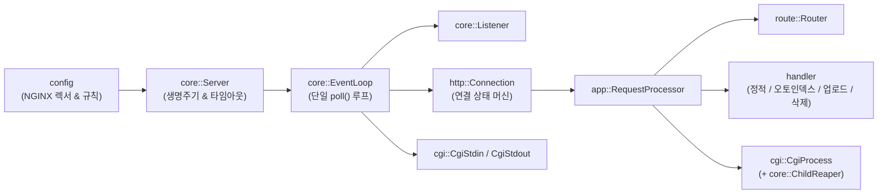

  
  <h1>42GS</h1>
  

    <strong>시스템 · 백엔드 엔지니어링 포트폴리오 — 바닥부터 구현하는 프로토콜 준수 서버와 네트워크 인프라</strong>
  

  

    
    
    
  

  

    <a href="https://github.com/42GS/.github/blob/main/profile/README.md">English</a> | <strong>한국어</strong>
  

---

## 개요

**42GS**는 42 커리큘럼에서 진행한 저수준 시스템 및 백엔드 인프라 프로젝트를 정리한 엔지니어링 포트폴리오입니다. **명세(RFC·POSIX) 기반 설계**, **외부 의존성 없는 직접 구현**, **실측과 자동화 테스트 기반 검증**을 핵심 원칙으로 삼고 있습니다.

### 핵심 역량 영역

| 영역 | 설계 · 구현 · 검증 내용 |
| :--- | :--- |
| **네트워크 · 시스템 I/O** | 단일 프로세스 `poll()` 이벤트 다중화, 논블로킹 소켓·파이프 I/O, POSIX 프로세스·시그널 생명주기(`fork`/`execve`/`waitpid`), FD 고갈 시 백프레셔 제어 |
| **프로토콜 · 백엔드 아키텍처** | RFC 9112 HTTP/1.1 증분 파싱, CGI/1.1(`RFC 3875`), NGINX 스타일 설정 파서 및 최장 접두사 라우팅, 연결 상태 머신(`keep-alive`, 파이프라이닝, `DRAIN`) |
| **검증 · 근거 중심 의사결정** | C++98 단위 테스트, Python 3 TCP 통합 테스트, Valgrind·Electric Fence 메모리 누수/오류 감사, `siege` 부하 테스트, OS별(`macOS` vs `Ubuntu 22.04`) 실측 기록 |

---

## 대표 프로젝트

### [`webserv`](https://github.com/42GS/webserv) — RFC 9112 준수 HTTP/1.1 웹 서버 (`C++98`)

외부 라이브러리 없이 **C++98**로 바닥부터 구현한 **HTTP/1.1 웹 서버**입니다. 단일 프로세스 내 하나의 `poll()` 이벤트 루프가 모든 리스닝 소켓, 클라이언트 연결, CGI 파이프를 다중화하며, 각 준비 이벤트당 최대 한 번의 논블로킹 `recv()`, `send()` 또는 파이프 I/O만 수행합니다.

* **백엔드 엔지니어링:** 연결 유지(`keep-alive`), HTTP 파이프라이닝, 청크(`chunked`) 본문 디코딩, `HEAD`/`GET`/`POST`/`DELETE`, `multipart/form-data` 업로드(`201`/`409`/`413`), CGI/1.1(`fork`/`execve`), NGINX 스타일 설정(`12`개 지시어) 및 `alias` 경계 검증 라우팅
* **시스템 · 보안 엔지니어링:** `EventLoop` 지연 핸들러 제거(`unwatched_`), FD 고갈 시 리스너 일시 정지/재개, `64 KiB` 청크 파일 스트리밍, TCP `RST` 방지용 `DRAIN` 상태(`RFC 9112 §9.6`), 상태별 타임아웃(Slowloris 방어), `httpoxy`(`CVE-2016-5385`) 차단, `stat()` 기반 `Clock`
* **검증 범위:** C++98 단위 테스트 **105/105 통과** (`make test`), Python TCP 통합 테스트 **11개 스위트(124개 케이스)**, Valgrind clean-exit 검증, `siege` 부하 테스트

* **상세 문서:** [저장소 바로가기](https://github.com/42GS/webserv) · [아키텍처 및 설계 의사결정](https://github.com/42GS/webserv/blob/main/docs/architecture.ko.md) · [설정 파일 레퍼런스](https://github.com/42GS/webserv/blob/main/docs/configuration.ko.md) · [릴리스 노트](https://github.com/42GS/webserv/blob/main/CHANGELOG.ko.md)

---

## 아키텍처 · 문서 아카이브

### [`webserv-wiki`](https://github.com/42GS/webserv-wiki) — 설계 결정 로그, OS 실측 데이터 및 기술 위키

`webserv` 개발·디펜스 과정에서 축적한 원문 명세 분석, OS 실측 실험, 아키텍처 의사결정 및 학습 노트를 정리한 엔지니어링 아카이브입니다.

* **원문 명세 및 OS 실측 (`wiki/sources/`):** RFC 9110/9112/3875/7578, NGINX 소스·동작, POSIX 명세 요약 및 `macOS` vs `Ubuntu 22.04` 실측 기록(half-closed pipe `poll()` 비트 차이, `413` 응답 후 drain vs TCP reset, `siege 4.0.7` 동작, Valgrind/Electric Fence 측정)
* **아키텍처 및 설계 결정 (`wiki/analysis/`):** [설계 결정 18건](https://github.com/42GS/webserv-wiki/blob/main/wiki/analysis/design-decisions.md), [과제-평가표 모순 분석](https://github.com/42GS/webserv-wiki/blob/main/wiki/analysis/subject-vs-evaluation.md), [모듈/인터페이스 설계](https://github.com/42GS/webserv-wiki/blob/main/wiki/analysis/design.md), [테스트 계획](https://github.com/42GS/webserv-wiki/blob/main/wiki/analysis/test-plan.md), [모의 평가 리포트](https://github.com/42GS/webserv-wiki/blob/main/wiki/analysis/mock-evaluation.md)
* **코드 해설 및 디펜스 노트 (`wiki/lessons/`):** 이론·RFC와 `webserv` 실제 코드 라인을 연결한 21편의 단계별 기술 노트(`00-guide` ~ `16-glossary`)

* **살펴보기:** [저장소 바로가기](https://github.com/42GS/webserv-wiki) · [과제 전체 개요](https://github.com/42GS/webserv-wiki/blob/main/wiki/overview.md) · [전체 위키 인덱스](https://github.com/42GS/webserv-wiki/blob/main/wiki/index.md)

---

## 저장소 맵 및 로드맵

| 저장소 | 기술 스택 | 역할 | 상태 |
| :--- | :--- | :--- | :--- |
| **[`42GS/webserv`](https://github.com/42GS/webserv)** | C++98, Python | RFC 9112 HTTP/1.1 &amp; CGI/1.1 웹 서버 (`poll()` 이벤트 루프) | 대표 프로젝트 · `v1.0.0` |
| **[`42GS/webserv-wiki`](https://github.com/42GS/webserv-wiki)** | Markdown | 설계 의사결정(ADR), OS 실측 기록 및 기술 위키 아카이브 | 문서 · 발표 아카이브 |
| **[`42GS/minishell`](https://github.com/42GS/minishell)** | C | POSIX 스타일 인터랙티브 셸 (렉서, 파서, 파이프, 시그널, 빌트인) | 추후 포트폴리오 정비 예정 |

---

## Maintainers

* **[@gdtknight](https://github.com/gdtknight)** (`yoshin`)
* **[@Sunbear95](https://github.com/Sunbear95)**
