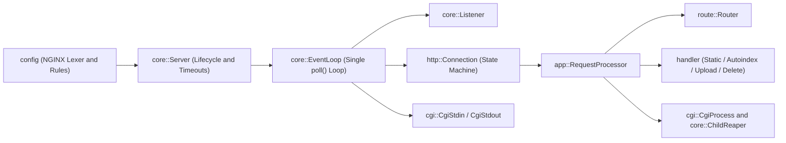
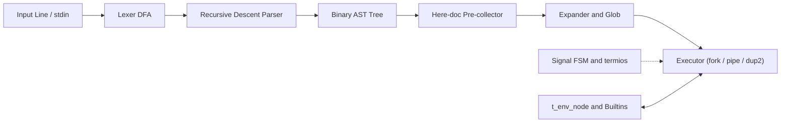

  
  <h1>42GS</h1>
  

    <strong>C/C++ 시스템 · 네트워크 프로그래밍 프로젝트 (RFC · POSIX)</strong>
  

  

    
    
  

  

    <strong>한국어</strong> | <a href="https://github.com/42GS/.github/blob/main/profile/README.en.md">English</a>
  

---

외부 라이브러리 없는 RFC · POSIX 명세 구현, `macOS` · `Ubuntu` 동작 실측, 자동화 검증(Valgrind · E2E · CI) 및 설계 위키 아카이브.

## 저장소

| 저장소 | 스택 | 구성 | 핵심 내용 · 검증 |
| :--- | :--- | :--- | :--- |
| **[`42GS/webserv`](https://github.com/42GS/webserv)** (`v1.0.0`) | C++98, `poll()`, Python | 2인 팀 (`yoshin`, `jyoo`) | RFC 9112 HTTP/1.1 &amp; CGI/1.1 서버 · 단위 `105/105`, TCP 통합 `124`건, Valgrind/EF/`siege` |
| **[`42GS/webserv-wiki`](https://github.com/42GS/webserv-wiki)** (`v1.0.1`) | Markdown | `yoshin` 작성 | 원문·OS 실측 `67`건, 위키 `111`편, ADR `19`건, 공개 학습 Wiki `21`장 |
| **[`42GS/minishell`](https://github.com/42GS/minishell)** (`v1.1.0`) | C99, POSIX.1-2017, Python | 개인 (`yoshin`) | 유닉스 셸 · 42evalhub `37/37`, 코어 `-50.6%` LOC, 누수 `0`건, CI `29~36s` |
| **[`42GS/minishell-wiki`](https://github.com/42GS/minishell-wiki)** (`v1.0.1`) | Markdown, Python | 개인 (`yoshin`) | 아키텍처 4부작·CS 심화·평가 매트릭스·회고록 `33`편, 7단계 린터 CI (`0 Errors`) |
| **[`42GS/ft_transcendence`](https://github.com/42GS/ft_transcendence)** | TypeScript, React, Fastify, PostgreSQL | 5인 팀 (오목·오델로 엔진/보드) | 2인 실시간 보드게임 플랫폼 (`Cyber Board Café`) · 정비 예정 |

구버전 비교 아카이브: [`42GS/minishell-old`](https://github.com/42GS/minishell-old) · [`42GS/webserv-old`](https://github.com/42GS/webserv-old)

---

## 핵심 프로젝트

### [`webserv`](https://github.com/42GS/webserv) (`v1.0.0`) · [`webserv-wiki`](https://github.com/42GS/webserv-wiki) (`v1.0.1`)

`C++98` · `POSIX Sockets` · `poll()` · `CGI/1.1` · `2인 팀 (2026.10.16 ~ 2026.10.29)`

외부 의존성 없는 RFC 9112 HTTP/1.1 &amp; CGI/1.1 서버 — 단일 프로세스 `poll()` 논블로킹 이벤트 루프 기반 멀티플렉싱

* **프로토콜 · 라우팅**
  * HTTP/1.1 `keep-alive`, 파이프라이닝, `Content-Length` · `chunked` 증분 파싱
  * `multipart/form-data` 업로드(`201`/`409`/`413`), `DELETE`(`204`), CGI/1.1(`fork`/`execve`, `10초` 타임아웃 `504`, `ChildReaper`)
  * NGINX 문법 `12`개 지시어, 최장 접두사 매칭, `alias` 경계 검사, `..` 경로 탈출 차단(`400`)
* **안정성 · 시스템 제약**
  * `1 MiB` 초과 파일 `64 KiB` 청크 스트리밍, 조기 오류 응답 후 `DRAIN` 상태 경유(TCP `RST` 회피)
  * 시간 함수 미허용 제약 대응 `stat()` 기반 `Clock`, FD 고갈 시 리스너 `POLLIN` 일시 중지/재개
  * `Proxy` 헤더 필터링(`httpoxy` / `CVE-2016-5385` 차단), CGI 출력 `16 MiB` 상한 및 `std::string::swap` 무복사 전달
* **검증 · 위키**
  * C++98 단위 `105/105`(`make test`), Python TCP 통합 `11`개 스위트(`124`건), Valgrind · Electric Fence · `siege`, Linux(`x86_64`)/macOS(`arm64`) 릴리스 CI
  * `webserv-wiki`: 원문 · OS 실측 `67`건, 위키 `111`편, ADR `19`건, [공개 학습 Wiki](https://github.com/42GS/webserv/wiki)(`21`장)

[구현 저장소](https://github.com/42GS/webserv) · [아키텍처 문서](https://github.com/42GS/webserv/blob/main/docs/architecture.md) · [설정 레퍼런스](https://github.com/42GS/webserv/blob/main/docs/configuration.md) · [릴리스 노트](https://github.com/42GS/webserv/blob/main/CHANGELOG.md) · [공개 Wiki](https://github.com/42GS/webserv/wiki) · [설계 위키](https://github.com/42GS/webserv-wiki) · [ADR 19건](https://github.com/42GS/webserv-wiki/blob/main/wiki/analysis/design-decisions.md)

---

### [`minishell`](https://github.com/42GS/minishell) (`v1.1.0`) · [`minishell-wiki`](https://github.com/42GS/minishell-wiki) (`v1.0.1`)

`C99` · `POSIX.1-2017` · `GNU Readline` · `Valgrind` · `GHCR CI` · `개인 프로젝트`

외부 셸 의존 없는 POSIX 유닉스 셸 — 선설계 아키텍처 명세 기반 C 구현 및 5계층 자동화 검증

* **파서 · IPC · 시그널**
  * DFA 렉서 → 재귀 하향 AST → Here-doc 사전 수집 → 확장 · Globbing → `(N-1)` 파이프 IPC 및 7대 빌트인
  * 단일 `g_signal_num` Async-Signal-Safe 4-상태 머신(`ctx->interrupted`로 `SIGINT` 중단과 `(exit 130)` 분리)
  * `O_CREAT | O_EXCL`(`0600`) + 즉시 `unlink()` 익명 Here-doc(64KB 파이프 교착 해소 및 `close_ast_heredocs()`)
  * `realloc` 미허용 대응 `O(N)` `t_strbuf`, 인용 마스크(`t_exp_buf.mask`) 기반 `*` Globbing
* **구버전 대비 재설계 (`minishell-old` 대조)**
  * 코어 코드 `-50.6%`(`7,883 -> 3,896` LOC, 전체 `9,283 -> 4,476` LOC), Norminette `0 errors`, Doxygen `58`파일 문서화
  * 금지 외부 심볼 `0`건(허용 `33`종), 42evalhub E2E 통과율 `20/37 (54.1%) -> 37/37 (100%)`
* **검증 · 위키**
  * C 단위 `7`종, Bash 차등 스모크 `47`종, 42evalhub `37`종, PTY 시그널 `8`종, Valgrind QA `13`종(힙 · FD 누수 `0`건)
  * GHCR 컨테이너 병렬화로 GitHub Actions CI `77~80s -> 29~36s` (`-62.3%`)
  * `minishell-wiki`: 아키텍처 4부작 · CS 심화 · 평가 매트릭스 · 회고록 `33`편, 7단계 린터 CI(`0 Errors`)

[구현 저장소](https://github.com/42GS/minishell) · [요약 Wiki](https://github.com/42GS/minishell/wiki) · [지식 베이스](https://github.com/42GS/minishell-wiki) · [전체 색인](https://github.com/42GS/minishell-wiki/blob/main/index.md) · [아키텍처 4부작](https://github.com/42GS/minishell-wiki/tree/main/wiki/architecture) · [구버전 비교 회고록](https://github.com/42GS/minishell-wiki/blob/main/wiki/eval/legacy_retrospective.md)

---

**Maintainer**: [@gdtknight](https://github.com/gdtknight) · **Collaborators**: [@Sunbear95](https://github.com/Sunbear95) · jyoo (`webserv`, `ft_transcendence`) · yunhpark · sipyeon · dong-hki (`ft_transcendence`)
