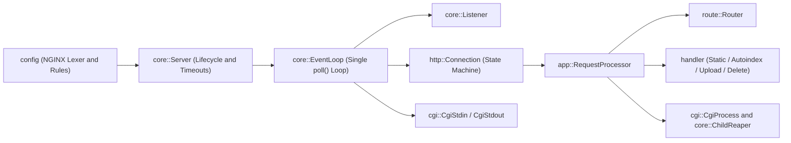
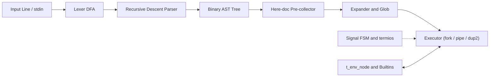

  
  <h1>42GS</h1>
  

    <strong>@gdtknight (yoshin)의 42 커리큘럼 C/C++ 시스템·네트워크 포트폴리오</strong>
  

  

    
    
  

  

    <strong>한국어</strong> | <a href="https://github.com/42GS/.github/blob/main/profile/README.en.md">English</a>
  

---

**42GS**는 **[@gdtknight](https://github.com/gdtknight) (`yoshin`)**이 42 커리큘럼에서 만든 C/C++ 시스템·네트워크 프로젝트와 설계 위키를 정리한 포트폴리오입니다. 외부 라이브러리 없이 RFC·POSIX 명세를 직접 구현하고, `macOS`·`Ubuntu` 실측과 자동화 검증 기록을 코드와 함께 남깁니다.

## 프로젝트

| 저장소 | 구성 · 역할 | 스택 | 핵심 내용 · 검증 |
| :--- | :--- | :--- | :--- |
| **[`42GS/webserv`](https://github.com/42GS/webserv)** (`v1.0.0`) | 2인 팀 (`yoshin`, `jyoo`) | C++98, `poll()`, Python | RFC 9112 HTTP/1.1 &amp; CGI/1.1 서버 · 단위 `105/105`, TCP 통합 `124`건, Valgrind/EF/`siege` |
| **[`42GS/webserv-wiki`](https://github.com/42GS/webserv-wiki)** (`v1.0.1`) | `yoshin` 작성 | Markdown | 원문·OS 실측 `67`건, 위키 `111`편, ADR `19`건, 공개 학습 Wiki `21`장 |
| **[`42GS/minishell`](https://github.com/42GS/minishell)** (`v1.1.0`) | 개인 1인 (`yoshin`) | C99, POSIX.1-2017, Python | 유닉스 셸 · 42evalhub `37/37`, 코어 `-50.6%` LOC, 누수 `0`건, CI `29~36s` |
| **[`42GS/minishell-wiki`](https://github.com/42GS/minishell-wiki)** (`v1.0.1`) | 개인 1인 (`yoshin`) | Markdown, Python | 아키텍처 4부작·CS 심화·평가 매트릭스·회고록 `33`편, 7단계 린터 CI (`0 Errors`) |
| **[`42GS/ft_transcendence`](https://github.com/42GS/ft_transcendence)** | 5인 팀 (`yoshin`: 오목·오델로 엔진/보드) | TypeScript, React, Fastify, PostgreSQL | 2인 실시간 보드게임 플랫폼 (`Cyber Board Café`) · 포트폴리오 정비 예정 |

> [`42GS/minishell-old`](https://github.com/42GS/minishell-old)와 [`42GS/webserv-old`](https://github.com/42GS/webserv-old)는 재설계 전후를 비교·회고하기 위해 보관 중인 구버전 아카이브입니다.

---

## 대표 프로젝트

### [`webserv`](https://github.com/42GS/webserv) (`v1.0.0`) · [`webserv-wiki`](https://github.com/42GS/webserv-wiki) (`v1.0.1`)

`2인 팀 (yoshin, jyoo · 2026.10.16 ~ 2026.10.29) · 위키 yoshin 작성`

외부 의존성 없이 **C++98**과 단일 프로세스 `poll()` 루프로 구현한 RFC 9112 HTTP/1.1 &amp; CGI/1.1 서버입니다. 리스닝 소켓, 클라이언트 연결, CGI 파이프를 하나의 이벤트 루프에서 논블로킹으로 처리합니다.

* **프로토콜·라우팅**: `keep-alive`, 파이프라이닝, 청크 증분 파싱, `multipart/form-data` 업로드(`201`/`409`/`413`), `DELETE`(`204`), CGI/1.1(`fork`/`execve`, `10초` 타임아웃 `504`), NGINX 문법 `12`개 지시어, 최장 접두사 매칭, `alias` 경계 검사, `..` 경로 탈출 차단(`400`)을 구현했습니다.
* **안정성·제약 대응**: `1 MiB` 초과 파일은 `64 KiB` 청크로 스트리밍하고, 조기 오류 응답 뒤에는 `DRAIN` 상태를 거쳐 TCP `RST`를 피합니다. 시간 함수 제약은 `stat()` 기반 `Clock`으로 우회했고, FD 고갈 시 리스너 일시 중지, `httpoxy`(`CVE-2016-5385`) 차단, CGI 출력(`16 MiB` 상한) `std::string::swap` 무복사 전달을 적용했습니다.
* **검증·위키**: C++98 단위 `105/105`, Python TCP 통합 `11`개 스위트(`124`건), Valgrind·Electric Fence·`siege`, Linux(`x86_64`)/macOS(`arm64`) 릴리스 CI를 갖췄습니다. `webserv-wiki`에는 원문·OS 실측 `67`건, 위키 `111`편, ADR `19`건과 [공개 학습 Wiki](https://github.com/42GS/webserv/wiki)(21장)를 남겼습니다.

[구현 저장소](https://github.com/42GS/webserv) · [아키텍처 문서](https://github.com/42GS/webserv/blob/main/docs/architecture.md) · [설정 레퍼런스](https://github.com/42GS/webserv/blob/main/docs/configuration.md) · [릴리스 노트](https://github.com/42GS/webserv/blob/main/CHANGELOG.md) · [공개 Wiki](https://github.com/42GS/webserv/wiki) · [설계 위키](https://github.com/42GS/webserv-wiki) · [ADR 19건](https://github.com/42GS/webserv-wiki/blob/main/wiki/analysis/design-decisions.md)

---

### [`minishell`](https://github.com/42GS/minishell) (`v1.1.0`) · [`minishell-wiki`](https://github.com/42GS/minishell-wiki) (`v1.0.1`)

`개인 프로젝트 (yoshin)`

표준 셸 도움 없이 **C99**와 **POSIX.1-2017** 시스템 콜(`GNU Readline`, `Valgrind`, `Docker (GHCR)`)로 구현한 유닉스 셸입니다. `minishell-wiki`에 아키텍처 명세를 먼저 확정한 뒤 C 구현과 5계층 자동화 검증을 진행했습니다.

* **설계·트러블슈팅**: DFA 렉서 → 재귀 하향 AST → Here-doc 사전 수집 → 확장·Globbing → `(N-1)` 파이프 IPC 및 7대 빌트인으로 구성했습니다. 단일 `g_signal_num` Async-Signal-Safe 4-상태 머신(`ctx->interrupted`), `O_CREAT | O_EXCL`+즉시 `unlink()` 익명 Here-doc(64KB 교착 해소), `O(N)` `t_strbuf`, 인용 마스크(`t_exp_buf.mask`) `*` Globbing을 적용했습니다.
* **구버전 대비 재설계**: `minishell-old` 대비 코어 코드를 `-50.6%` (`7,883 -> 3,896` LOC) 줄이면서 Norminette `0 errors`와 Doxygen `58`개 파일 문서화를 마쳤습니다. 금지 외부 심볼 `0`건, 42evalhub E2E 통과율은 `20/37 (54.1%)`에서 `37/37 (100%)`로 개선했습니다.
* **검증·위키**: C 단위 `7`종, Bash 차등 스모크 `47`종, 42evalhub `37`종, PTY 시그널 `8`종, Valgrind QA `13`종(힙·FD 누수 `0`건)을 통과하며, GHCR 컨테이너 병렬화로 CI 시간을 `77~80s`에서 `29~36s` (`-62.3%`)로 단축했습니다. `minishell-wiki`에는 아키텍처 4부작·CS 심화·평가 매트릭스·회고록 `33`편과 7단계 린터 CI(`0 Errors`)를 구축했습니다.

[구현 저장소](https://github.com/42GS/minishell) · [요약 Wiki](https://github.com/42GS/minishell/wiki) · [지식 베이스](https://github.com/42GS/minishell-wiki) · [전체 색인](https://github.com/42GS/minishell-wiki/blob/main/index.md) · [아키텍처 4부작](https://github.com/42GS/minishell-wiki/tree/main/wiki/architecture) · [구버전 비교 회고록](https://github.com/42GS/minishell-wiki/blob/main/wiki/eval/legacy_retrospective.md)

---

**Maintainer**: **[@gdtknight](https://github.com/gdtknight)** (`yoshin`)  
**Collaborators**: **[@Sunbear95](https://github.com/Sunbear95)** (`42GS` 멤버) · `jyoo` (`webserv`) · `jyoo`, `yunhpark`, `sipyeon`, `dong-hki` (`ft_transcendence`)
