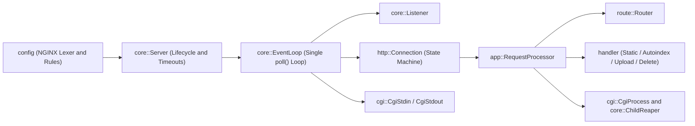
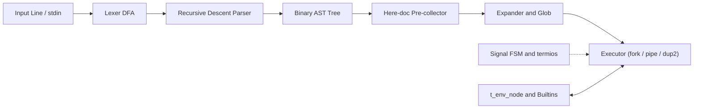

  
  <h1>42GS</h1>
  

    <strong>@gdtknight (yoshin)의 42 커리큘럼 C/C++ 시스템·네트워크 프로젝트 포트폴리오</strong>
  

  

    
    
  

  

    <strong>한국어</strong> | <a href="https://github.com/42GS/.github/blob/main/profile/README.en.md">English</a>
  

---

## 소개

**42GS**는 **[@gdtknight](https://github.com/gdtknight) (`yoshin`)**이 42 커리큘럼에서 진행한 시스템·네트워크 프로젝트와 설계 문서를 모아 둔 포트폴리오입니다. 개인 프로젝트와 팀 프로젝트를 구분해 적었고, 협업자 정보도 각 항목에 함께 밝혔습니다.

모든 프로젝트는 비슷한 흐름으로 진행했습니다. 구현에 앞서 RFC·POSIX 1차 명세를 직접 읽고 `macOS`와 `Ubuntu`의 동작 차이를 측정한 뒤, 외부 라이브러리 없이 시스템 콜만으로 핵심 엔진을 작성했습니다. 이후 단위·통합·메모리 누수·CI 검증을 붙이고, 설계 판단과 구버전 대비 회고까지 위키 저장소에 남겼습니다.

### 빠른 열람 가이드

* **전체 역량과 검증 수치 요약**: 아래 [대표 프로젝트 한눈에 보기](#대표-프로젝트-한눈에-보기) 표에서 `webserv`와 `minishell`의 범위·성과를 먼저 확인할 수 있습니다.
* **네트워크 서버 설계와 의사결정 근거**: [`webserv` 아키텍처 문서](https://github.com/42GS/webserv/blob/main/docs/architecture.md)와 [`webserv-wiki` ADR 19건](https://github.com/42GS/webserv-wiki/blob/main/wiki/analysis/design-decisions.md)을 권장합니다.
* **파서·IPC·시그널 구현과 재설계 성과**: [`minishell`](https://github.com/42GS/minishell)과 [`minishell-wiki` 구버전 비교 회고록](https://github.com/42GS/minishell-wiki/blob/main/wiki/eval/legacy_retrospective.md)에 전후 계측 수치를 정리했습니다.

---

## 대표 프로젝트 한눈에 보기

| 프로젝트 | 구성 및 역할 | 주요 스택 | 핵심 검증 결과 | 설계 · 회고 아카이브 |
| :--- | :--- | :--- | :--- | :--- |
| **[`webserv`](https://github.com/42GS/webserv)** (`v1.0.0`) | 2인 팀 (`yoshin`, `jyoo`) 위키(`webserv-wiki`) `yoshin` 작성 | C++98, POSIX Sockets, `poll()`, CGI/1.1, Python | C++98 단위 `105/105`, TCP 통합 `124`건, Valgrind · Electric Fence · `siege` 확인 | **[`webserv-wiki`](https://github.com/42GS/webserv-wiki)** (`v1.0.1`) 원문·OS 실측 `67`건 · 위키 `111`편 · ADR `19`건 |
| **[`minishell`](https://github.com/42GS/minishell)** (`v1.1.0`) | 개인 1인 (`yoshin`) 설계 · 구현 · QA · CI 전담 | C99, POSIX.1-2017, Readline, Valgrind, GHCR CI | 42evalhub `37/37` (`100%`), 코어 `-50.6%` LOC, 힙·FD 누수 `0`건 · CI `29~36s` | **[`minishell-wiki`](https://github.com/42GS/minishell-wiki)** (`v1.0.1`) 문서 `33`편 · 7단계 린터 CI (`0 Errors`) |

---

## 대표 프로젝트

### [`webserv`](https://github.com/42GS/webserv) (`v1.0.0`) · [`webserv-wiki`](https://github.com/42GS/webserv-wiki) (`v1.0.1`)

> 2인 팀 프로젝트 (`yoshin`, `jyoo` · 2026.10.16 ~ 2026.10.29) · `webserv-wiki` `yoshin` 작성

외부 라이브러리 없이 **C++98**과 POSIX 시스템 콜만으로 구현한 RFC 9112 준수 HTTP/1.1 & CGI/1.1 웹 서버입니다. 단일 프로세스 안의 `poll()` 루프 하나로 리스닝 소켓, 클라이언트 연결, CGI 파이프를 함께 감시하며, 준비 이벤트가 올 때마다 논블로킹 I/O를 한 번씩만 실행합니다.

* **프로토콜과 라우팅**: 연결 유지(`keep-alive`), HTTP 파이프라이닝, `Content-Length`와 `Transfer-Encoding: chunked` 증분 파싱, `multipart/form-data` 업로드(`201`/`409`/`413`), `DELETE`(`204`), CGI/1.1(`fork`/`execve`, `10초` 타임아웃 `504`, `ChildReaper`)을 처리합니다. NGINX 문법(`12`개 지시어) 설정을 지원하고 최장 접두사 매칭, `alias` 경로 경계 검사, `..` 경로 탈출 `400` 차단을 적용했습니다.
* **운영 안정성과 과제 제약 대응**: `1 MiB`를 넘는 파일은 `64 KiB` 조각으로 스트리밍하며, 조기 오류 응답 뒤에는 `DRAIN` 상태를 거쳐 TCP `RST`를 피합니다. 표준 시간 함수 금지 제약은 `stat()` 기반 `Clock`으로 해결하고, FD가 고갈되면 리스너 `POLLIN`을 잠시 멈췄다 재개하도록 구현했습니다. 또한 `Proxy` 헤더를 걸러 `httpoxy`(`CVE-2016-5385`)를 차단했고, CGI 출력(`16 MiB` 상한)은 `std::string::swap`으로 복사 없이 전달합니다.
* **검증 및 배포**: C++98 단위 테스트 **105/105 통과**(`make test`), Python 3 TCP 통합 테스트 **11개 스위트(124개 케이스)**, Valgrind·Electric Fence·`siege` 부하 테스트를 확인했고, GitHub Actions CI에서 Linux(`x86_64`)와 macOS(`arm64`) 릴리스 바이너리를 빌드합니다.

설계 단계부터 함께 운영한 [`webserv-wiki`](https://github.com/42GS/webserv-wiki)에는 `raw/` 원문·실측 **67건**(외부 명세 53건 + `macOS`·`Ubuntu 22.04` 실측 14건)을 바탕으로 작성한 위키 **111편**(`sources` 66, `concepts` 14, `analysis` 6, `lessons` 21, 최상위 4)과 **아키텍처 의사결정(ADR) 19건**을 모았습니다. 학습용 노트 21장과 개념 문서 13장은 [공개 GitHub Wiki](https://github.com/42GS/webserv/wiki)로도 읽을 수 있습니다.

* **바로 보기**: [구현 저장소](https://github.com/42GS/webserv) · [아키텍처 문서](https://github.com/42GS/webserv/blob/main/docs/architecture.md) · [설정 레퍼런스](https://github.com/42GS/webserv/blob/main/docs/configuration.md) · [릴리스 노트](https://github.com/42GS/webserv/blob/main/CHANGELOG.md) · [공개 Wiki](https://github.com/42GS/webserv/wiki) · [설계 위키 저장소](https://github.com/42GS/webserv-wiki) · [ADR 19건](https://github.com/42GS/webserv-wiki/blob/main/wiki/analysis/design-decisions.md) · [전체 개요](https://github.com/42GS/webserv-wiki/blob/main/wiki/overview.md)

---

### [`minishell`](https://github.com/42GS/minishell) (`v1.1.0`) · [`minishell-wiki`](https://github.com/42GS/minishell-wiki) (`v1.0.1`)

> 개인 프로젝트 (`yoshin` 1인 설계 · 구현 · QA · CI 전담)

표준 셸의 도움 없이 **C99**와 **POSIX.1-2017** 시스템 콜(`GNU Readline`, `Valgrind`, `Docker (GHCR)`, `GitHub Actions`, `Python`)만으로 구현한 유닉스 셸입니다. [`minishell-wiki`](https://github.com/42GS/minishell-wiki)에 파서·실행 엔진·시그널·빌트인 명세를 먼저 확정하고 C 구현과 5계층 자동화 검증을 진행했으며, 구현 뒤 구버전 비교 회고록까지 더해 총 **33편**의 지식 베이스를 완성했습니다.

#### 핵심 기술 문제 해결

* 시그널 핸들러는 `volatile sig_atomic_t g_signal_num` 한 곳에만 기록해 Async-Signal-Safe 규칙을 지켰고, `ctx->interrupted`로 `SIGINT` 중단과 정상 `(exit 130)`을 구분해 `&&`/`||` 단락 평가 오작동을 막았습니다.
* 파이프 기반 Here-doc의 64KB 커널 버퍼 교착을 피하려고 `O_CREAT | O_EXCL`(`0600`)로 열고 즉시 `unlink()`하는 익명 파일과 `close_ast_heredocs()` 형제 FD 정리를 적용했습니다.
* `realloc`이 금지된 제약 아래에서는 용량 2배 확장 버퍼 `t_strbuf`를 직접 구현해 확장기 누적 비용을 `O(N)`으로 낮췄고, 문자 버퍼와 나란히 유지하는 인용 마스크(`t_exp_buf.mask`)로 따옴표 안의 `*` 와일드카드 확장을 제어했습니다.

#### 재설계 성과, 5계층 검증 및 지식 베이스

과거 구현(`minishell-old`)을 봉인해 두고 새로 설계한 뒤 동일 머신(`LC_ALL=C`)에서 대조한 결과, `libft` 제외 코어 코드량을 `7,883 -> 3,896` LOC(**`-50.6%`**, 전체 `9,283 -> 4,476` LOC)로 줄이면서 42 Norminette `0 errors`와 **58개 파일 Doxygen 문서화**를 마쳤습니다. 금지 외부 심볼 `0`건(허용 `33`종)과 단일 전역변수 제약을 지켰고, 42evalhub 5대 E2E 통과율은 `20/37`(`54.1%`, 타임아웃 3건)에서 **`37/37`(`100%`)**로 끌어올렸습니다.

검증은 C 단위 테스트 `7`종, Bash 차등 스모크 `47`종, 42evalhub `37`종, 실제 PTY 시그널 `8`종, Valgrind QA `13`종(힙·FD 누수 `0`건)으로 구성했습니다. 경량 이미지(`ghcr.io/42gs/minishell-ci:latest`)와 정적 아카이브 재사용·병렬화를 도입해 GitHub Actions 실행 시간도 `77~80s`에서 **`29~36s`(`-62.3%`)**로 줄였습니다. 설계 문서 저장소인 [`minishell-wiki`](https://github.com/42GS/minishell-wiki)에는 시스템 아키텍처 4부작, OS·컴파일러 CS 심화 4부작, 허용 함수 53종 매트릭스, 42evalhub 평가 매트릭스, 회고록을 담았고 7단계 마크다운·Mermaid 린터(`scripts/lint_wiki.py`)를 CI로 돌려 `0 Errors`를 유지합니다.

* **바로 보기**: [구현 저장소](https://github.com/42GS/minishell) · [요약 GitHub Wiki](https://github.com/42GS/minishell/wiki) · [지식 베이스 저장소](https://github.com/42GS/minishell-wiki) · [전체 색인](https://github.com/42GS/minishell-wiki/blob/main/index.md) · [아키텍처 4부작](https://github.com/42GS/minishell-wiki/tree/main/wiki/architecture) · [구버전 비교 회고록](https://github.com/42GS/minishell-wiki/blob/main/wiki/eval/legacy_retrospective.md)

---

## 전체 저장소 목록

| 저장소 | 기술 스택 | 구성 · 담당 | 설명 | 상태 |
| :--- | :--- | :--- | :--- | :--- |
| **[`42GS/webserv`](https://github.com/42GS/webserv)** | C++98, Python | 2인 팀 (`yoshin`, `jyoo`) | RFC 9112 HTTP/1.1 & CGI/1.1 웹 서버 (`poll()` 이벤트 루프) | 대표 (`v1.0.0`) |
| **[`42GS/webserv-wiki`](https://github.com/42GS/webserv-wiki)** | Markdown | `yoshin` 작성 | 원문 인용, OS 실측, ADR 19건 및 학습 노트 아카이브 | 대표 (`v1.0.1`) |
| **[`42GS/minishell`](https://github.com/42GS/minishell)** | C99, Python | 개인 1인 (`yoshin`) | POSIX.1-2017 유닉스 셸 (DFA, AST, IPC, 5계층 검증·CI) | 대표 (`v1.1.0`) |
| **[`42GS/minishell-wiki`](https://github.com/42GS/minishell-wiki)** | Markdown | 개인 1인 (`yoshin`) | 4부작 아키텍처 명세, CS 심화, 평가 매트릭스, 회고록 | 대표 (`v1.0.1`) |
| **[`42GS/ft_transcendence`](https://github.com/42GS/ft_transcendence)** | TypeScript, React, Fastify, PostgreSQL | 5인 팀 (`yoshin`: 오목·오델로 엔진/보드) | 2인 실시간 웹 보드게임 플랫폼 (`Cyber Board Café`) | 포트폴리오 정비 예정 |

> **참고 아카이브**: [`42GS/minishell-old`](https://github.com/42GS/minishell-old)와 [`42GS/webserv-old`](https://github.com/42GS/webserv-old)는 재설계 전후의 코드 구조와 테스트 결과를 대조·회고하기 위해 남겨 둔 구버전 저장소입니다.

---

## Maintainer & Collaborators

* **Portfolio Owner & Maintainer**: **[@gdtknight](https://github.com/gdtknight)** (`yoshin`) — `42GS` 관리, `minishell` / `minishell-wiki` 단독 설계·구현·QA·CI, `webserv` 공동 구현 및 `webserv-wiki` 작성, `ft_transcendence` 게임 엔진·보드 UI 담당
* **Organization Member & Project Collaborators**: **[@Sunbear95](https://github.com/Sunbear95)** (`42GS` 멤버) · `jyoo` (`webserv` 공동 구현) · `jyoo`, `yunhpark`, `sipyeon`, `dong-hki` (`ft_transcendence` 팀원)
