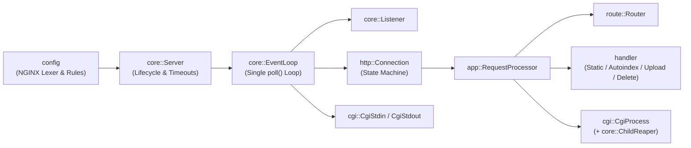

  
  <h1>42GS</h1>
  

    <strong>Systems &amp; Backend Engineering Portfolio — Protocol-Compliant Servers and Network Infrastructure Built from Scratch</strong>
  

  

    
    
    
  

  

    <strong>English</strong> | <a href="https://github.com/42GS/.github/blob/main/profile/README.ko.md">한국어</a>
  

---

## Overview

**42GS** is an engineering workspace showcasing low-level systems and backend infrastructure projects developed through the 42 curriculum—focused on **specification-driven design**, **zero-dependency implementations**, and **empirical verification**.

### Engineering Focus

| Pillar | What We Build &amp; Verify |
| :--- | :--- |
| **Network &amp; Systems I/O** | Single-process `poll()` event multiplexing, non-blocking sockets and pipes, POSIX process/signal lifecycle (`fork`/`execve`/`waitpid`), FD-exhaustion backpressure |
| **Protocol &amp; Backend Design** | Incremental RFC 9112 HTTP/1.1 parsing, CGI/1.1 (`RFC 3875`), NGINX-style configuration &amp; longest-prefix routing, connection state machines (`keep-alive`, pipelining, `DRAIN`) |
| **Verification &amp; Evidence** | Unit test suites (`C++98`), TCP integration suites (`Python 3`), Valgrind &amp; Electric Fence memory audits, `siege` stress testing, cross-OS probes (`macOS` vs. `Ubuntu 22.04`) |

---

## Featured Project

### [`webserv`](https://github.com/42GS/webserv) — RFC 9112 HTTP/1.1 Web Server (`C++98`)

An HTTP/1.1 web server built from scratch in **C++98 with zero external dependencies**. A single OS process multiplexes every listening socket, client connection, and CGI pipe through one `poll()` event loop—performing at most one non-blocking `recv()`, `send()`, or pipe I/O per readiness event.

* **Backend Engineering:** Persistent connections (`keep-alive`), HTTP pipelining, chunked transfer decoding, `HEAD`/`GET`/`POST`/`DELETE`, `multipart/form-data` uploads (`201`/`409`/`413`), CGI/1.1 (`fork`/`execve`), NGINX-style config (`12` directives) with longest-prefix routing and `alias` boundary checks.
* **Systems &amp; Security Engineering:** Deferred `EventLoop` unwatching (`unwatched_`), FD-exhaustion listener pause/resume, `64 KiB` chunked file streaming, `DRAIN` state (`RFC 9112 §9.6`) to prevent TCP `RST`, per-state timeouts (Slowloris defense), `httpoxy` (`CVE-2016-5385`) mitigation, and `stat()`-based `Clock`.
* **Verification Scope:** **105/105** C++98 unit tests (`make test`), **11** Python TCP integration suites (**124** test cases), Valgrind clean-exit checks, and `siege` load benchmarks.

* **Deep Dives:** [Repository](https://github.com/42GS/webserv) · [Architecture &amp; Design](https://github.com/42GS/webserv/blob/main/docs/architecture.md) · [Configuration Reference](https://github.com/42GS/webserv/blob/main/docs/configuration.md) · [Changelog &amp; Releases](https://github.com/42GS/webserv/blob/main/CHANGELOG.md)

---

## Architecture &amp; Engineering Archive

### [`webserv-wiki`](https://github.com/42GS/webserv-wiki) — Design Decisions, OS Probes &amp; Knowledge Base

The companion engineering wiki and presentation archive behind `webserv`—capturing primary-source research, OS-level empirical measurements, and post-implementation study notes *(written in Korean with English technical references)*.

* **Primary Sources &amp; OS Benchmarks (`wiki/sources/`):** Annotated notes on RFC 9110/9112/3875/7578, NGINX source/behavior, POSIX specs, and empirical comparisons between `macOS` and `Ubuntu 22.04` (half-closed pipe `poll()` bits, `413` drain vs. TCP reset, `siege 4.0.7` behavior, Valgrind / Electric Fence audits).
* **Architecture &amp; Decision Log (`wiki/analysis/`):** [18 documented design decisions](https://github.com/42GS/webserv-wiki/blob/main/wiki/analysis/design-decisions.md), [subject-vs-evaluation conflict analysis](https://github.com/42GS/webserv-wiki/blob/main/wiki/analysis/subject-vs-evaluation.md), [module interface design](https://github.com/42GS/webserv-wiki/blob/main/wiki/analysis/design.md), [test plan](https://github.com/42GS/webserv-wiki/blob/main/wiki/analysis/test-plan.md), and [mock evaluation report](https://github.com/42GS/webserv-wiki/blob/main/wiki/analysis/mock-evaluation.md).
* **Structured Walkthrough (`wiki/lessons/`):** 21 progressive engineering lessons (`00-guide` through `16-glossary`) mapping theory and RFCs directly to `webserv` source lines and defense Q&amp;A.

* **Explore:** [Repository](https://github.com/42GS/webserv-wiki) · [Project Overview](https://github.com/42GS/webserv-wiki/blob/main/wiki/overview.md) · [Full Wiki Index](https://github.com/42GS/webserv-wiki/blob/main/wiki/index.md)

---

## Repository Map &amp; Roadmap

| Repository | Stack | Role | Status |
| :--- | :--- | :--- | :--- |
| **[`42GS/webserv`](https://github.com/42GS/webserv)** | C++98, Python | RFC 9112 HTTP/1.1 &amp; CGI/1.1 server (`poll()` event loop) | Featured · `v1.0.0` |
| **[`42GS/webserv-wiki`](https://github.com/42GS/webserv-wiki)** | Markdown | Engineering knowledge base, OS measurements &amp; ADR archive | Documentation Archive |
| **[`42GS/minishell`](https://github.com/42GS/minishell)** | C | POSIX-style interactive shell (lexer, AST/parser, pipes, signals, builtins) | Upcoming Portfolio Polish |

---

## Maintainers

* **[@gdtknight](https://github.com/gdtknight)** (`yoshin`)
* **[@Sunbear95](https://github.com/Sunbear95)**
