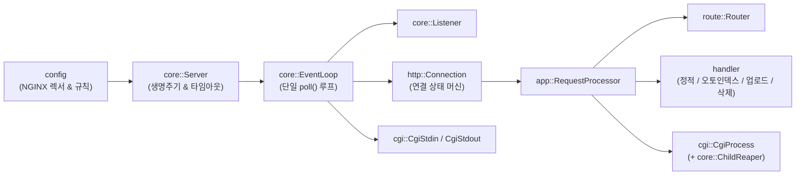

  
  <h1>42GS</h1>
  

    <strong>42 커리큘럼에서 진행한 C/C++ 시스템·네트워크 프로젝트 포트폴리오입니다.</strong>
  

  

    
    
  

  

    <strong>한국어</strong> | <a href="https://github.com/42GS/.github/blob/main/profile/README.en.md">English</a>
  

---

## 소개

**42GS**는 42 커리큘럼에서 만든 시스템·백엔드 프로젝트를 정리하는 팀 저장소입니다. 외부 라이브러리 없이 RFC와 POSIX 명세를 직접 읽고 구현하며, `macOS`와 `Ubuntu` 환경에서 동작 차이를 실측한 뒤 코드와 문서로 남깁니다.

---

## 대표 프로젝트

### [`webserv`](https://github.com/42GS/webserv) — C++98 HTTP/1.1 웹 서버

외부 의존성 없이 **C++98**로 작성한 RFC 9112 준수 HTTP/1.1 서버입니다. 단일 프로세스 안의 `poll()` 루프 하나로 리스닝 소켓, 클라이언트 연결, CGI 파이프를 모두 감시하며, 준비 이벤트가 올 때마다 논블로킹 I/O를 한 번씩만 수행합니다.

* **프로토콜과 라우팅:** 연결 유지(`keep-alive`), 파이프라이닝, 청크(`chunked`) 디코딩, `multipart/form-data` 업로드(`201`/`409`/`413`), CGI/1.1(`fork`/`execve`)을 지원합니다. 설정은 NGINX 문법(`12`개 지시어)을 따르며 최장 접두사 매칭과 `alias` 경로 경계 검사를 적용했습니다.
* **운영 안정성과 제약 대응:** `1 MiB`를 넘는 파일은 `64 KiB` 단위로 나누어 전송하고, 연결을 닫기 전 `DRAIN` 상태를 거쳐 TCP `RST`를 피합니다. 시간 함수 사용 제약은 `stat()` 기반 `Clock`으로 해결했고, FD 고갈 시 리스너를 잠시 멈췄다 재개하며 `httpoxy`(`CVE-2016-5385`) 헤더를 차단합니다.
* **검증 범위:** C++98 단위 테스트 **105/105 통과**(`make test`), Python TCP 통합 테스트 **11개 스위트(124개 케이스)**, Valgrind·Electric Fence 메모리 점검, `siege` 부하 테스트로 동작을 확인했습니다.

* **관련 문서:** [저장소](https://github.com/42GS/webserv) · [아키텍처 문서](https://github.com/42GS/webserv/blob/main/docs/architecture.ko.md) · [설정 파일 레퍼런스](https://github.com/42GS/webserv/blob/main/docs/configuration.ko.md) · [릴리스 노트](https://github.com/42GS/webserv/blob/main/CHANGELOG.ko.md)

---

## 설계 · 검증 아카이브

### [`webserv-wiki`](https://github.com/42GS/webserv-wiki) — 설계 근거와 OS 실측 기록

`webserv`를 개발하고 디펜스를 준비하면서 모은 원문 명세, OS 실험 결과, 설계 판단을 정리한 위키입니다.

* **`wiki/sources/`:** RFC 9110·9112·3875·7578, NGINX 소스·동작, POSIX 명세 요약과 함께 `macOS`와 `Ubuntu 22.04`에서 직접 측정한 차이(half-closed pipe의 `poll()` 비트, `413` 응답 후 연결 종료 방식, `siege 4.0.7` 동작 등)를 기록했습니다.
* **`wiki/analysis/`:** [설계 결정 18건](https://github.com/42GS/webserv-wiki/blob/main/wiki/analysis/design-decisions.md)을 비롯해 [과제·평가표 차이 분석](https://github.com/42GS/webserv-wiki/blob/main/wiki/analysis/subject-vs-evaluation.md), [모듈 설계](https://github.com/42GS/webserv-wiki/blob/main/wiki/analysis/design.md), [테스트 계획](https://github.com/42GS/webserv-wiki/blob/main/wiki/analysis/test-plan.md), [모의 평가 기록](https://github.com/42GS/webserv-wiki/blob/main/wiki/analysis/mock-evaluation.md)을 남겼습니다.
* **`wiki/lessons/`:** RFC와 시스템 콜 개념을 실제 `webserv` 코드 위치에 연결해 정리한 21편의 학습 노트입니다.

* **살펴보기:** [저장소](https://github.com/42GS/webserv-wiki) · [전체 개요](https://github.com/42GS/webserv-wiki/blob/main/wiki/overview.md) · [위키 인덱스](https://github.com/42GS/webserv-wiki/blob/main/wiki/index.md)

---

## 저장소 목록

| 저장소 | 기술 스택 | 설명 | 상태 |
| :--- | :--- | :--- | :--- |
| **[`42GS/webserv`](https://github.com/42GS/webserv)** | C++98, Python | RFC 9112 HTTP/1.1 &amp; CGI/1.1 웹 서버 (`poll()` 이벤트 루프) | 대표 프로젝트 (`v1.0.0`) |
| **[`42GS/webserv-wiki`](https://github.com/42GS/webserv-wiki)** | Markdown | 설계 의사결정, OS 실측 기록 및 기술 위키 아카이브 | 문서 · 발표 아카이브 |
| **[`42GS/minishell`](https://github.com/42GS/minishell)** | C | POSIX 스타일 인터랙티브 셸 (렉서, 파서, 파이프, 시그널, 빌트인) | 문서 · 테스트 정비 예정 |

---

## Maintainers

* **[@gdtknight](https://github.com/gdtknight)** (`yoshin`)
* **[@Sunbear95](https://github.com/Sunbear95)**
